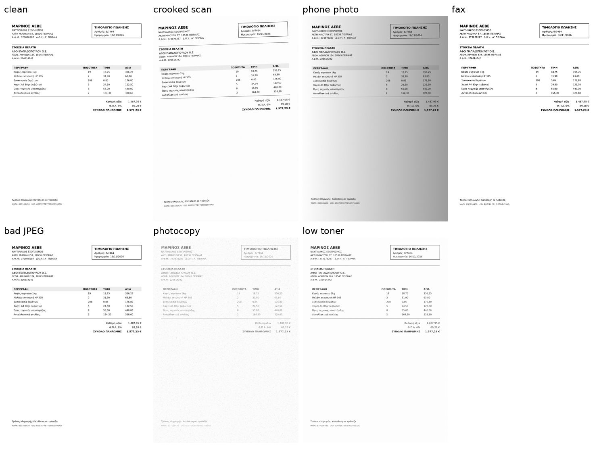

# docai — Greek documents → structured data, on your own hardware

Reads Greek invoices and scanned legal documents and turns them into structured JSON / CSV.
It runs entirely on a local GPU, so no document ever leaves the building.

The design rule: **a wrong number that looks right is the only error that costs money.** The
system would rather say *"check these 3 fields"* than guess. Everything is measured by
**silent errors**, meaning answers that were reported as confident and were wrong.

## How it works

```
page ──► PDF text layer? ──yes──► exact words + boxes (0.01 s, no OCR)
            │ no
            ▼
   Greek OCR (PaddleOCR el_PP-OCRv5)   ~0.5 s
   Latin OCR (second opinion on every digit)
            │
            ▼
   geometry: each label finds the value to its right (no LLM "understanding" the page)
            │
            ▼
   proofs:  net + VAT = gross · quantity × price = line total · both readers agree
            │
            ├── proven ──────────► confident field
            └── not proven ──────► crop the region → local vision model (Qwen3-VL-4B)
                                    still not proven → "needs review"
```

- **Arithmetic can veto.** If net + ΦΠΑ ≠ total, *no* money field is confident, even when both
  readers agree. A reader can agree with itself about a wrong number, but it can't make the page
  add up.
- **Skew-corrected rows.** On a page scanned 1.8° crooked, the number columns slid one row off
  the descriptions. Measuring the skew from the text boxes fixed it: line-item cells went from
  74.8% to 88.4%.
- **Per-row arithmetic.** quantity × price = total repairs a digit the scanner lost and flags rows
  that don't multiply out.
- **Greek-specific fixes.** The Greek OCR writes capital omicron `Ο` for zero (`3868334Ο7`). It is
  folded back only inside runs that are already numeric, never inside words.
- **Vision model only on escalation.** Sending just the cropped table takes 2.6 s instead of 19 s
  for a full page, and reads damaged Greek *better*.

## Results

### Invoices: 60 deliberately damaged pages

`make_invoice.py` generates Greek invoices with known answers (ΑΦΜ, ΔΟΥ, ΦΠΑ, ΜΑΡΚ/UID).
`degrade.py` then makes six damaged versions of each one, because a score on a clean PNG means
nothing:



| | vision model on every page | **OCR-first (this repo)** |
|---|---|---|
| header fields correct | 99.5% | **99.8%** (98.7% exact + 7 cosmetic) |
| **silent errors** | 0 | **0** |
| fields sent to a human | 34 | **8** |
| line-item cells | 98.7% | 97.3% |
| speed | 19.1 s/page | **5.4 s/page** |
| clean page | 19 s | **1.0 s** |
| digital PDF | 19 s | **0.01 s, 100% of fields** |

On the clean set the score is 100/100 fields with 0 silent errors and 0.7 s/page, and the vision
model never runs.

What an accountant gets is in [`examples/report/`](examples/report/): `invoices.csv`, `lines.csv`
and a short `review.txt` of what to check by hand.

### Real Greek documents

- **Government Gazette (ΦΕΚ) pages:** modern issues carry their own text layer, which makes a free
  ground truth. 20 pages from 2005–2024: **97.7% word recall, 98.1% precision, 1.7% character
  error rate, 0.69 s/page** (`real_bench.py`).
- **Scanned legal opinions (ΝΣΚ), 1951–2026:** these are scored against the catalogue that ΝΣΚ's
  own staff wrote (`nsk_bench.py`, `legal_extract.py`, `legal_eval.py`):

| era | docs | number | date | bench | speed |
|---|---|---|---|---|---|
| 2000–2026 | 9 | 7/9 | 9/9 | 9/9 | 1.1 s/page |
| 1980–1999 | 6 | 1/6 | 3/6 | 5/6 | 2.6 s/page |
| 1951–1979 | 9 | 1/9 | 3/9 | 7/9 | 4.1 s/page |

**0 silent errors across all 24.** On typewriter-era scans the system refuses instead of
guessing, which is the intended behaviour. It also found 82% of the statutes the catalogue lists
as cited.

Measured on a Tesla P100 16 GB.

## Usage

```bash
pip install -r requirements.txt

python make_invoice.py 10 samples              # synthetic invoices + ground truth (10 included)
python degrade.py samples samples_hard         # 6 damaged versions of each
python fast_extract.py samples_hard/*.png --out results.json --no-vlm
python evaluate.py results.json samples_hard   # scores, headline = silent errors
python report.py results.json out/             # invoices.csv, lines.csv, review.txt
```

For the vision-model escalation, run a llama.cpp server with Qwen3-VL-4B-Instruct (+ mmproj) and
set `VLM_SERVER=http://127.0.0.1:8099`. Use `PADDLE_DEVICE=cpu` if there's no GPU.

| file | what it does |
|---|---|
| `fast_extract.py` | the pipeline: OCR + geometry + proofs, vision model only on escalation |
| `extract.py` | the original vision-model-first version, kept as the baseline |
| `legal_extract.py` | the same approach for scanned legal opinions (number, date, bench, citations) |
| `make_invoice.py`, `to_pdf.py` | synthetic invoices as PNG and as real text PDFs |
| `degrade.py` | scan / photo / fax / JPEG / photocopy / toner damage |
| `evaluate.py`, `legal_eval.py` | scoring against ground truth |
| `real_bench.py`, `nsk_bench.py` | benchmarks on real ΦΕΚ and ΝΣΚ documents (bring your own PDFs: `FEK_ROOT`, `NSK_ROOT`) |
| `report.py` | CSV + review list for an accountant |

## Limits

- The invoice numbers come from **synthetic** invoices: one generator, one layout family and
  simulated damage. Real invoices from many different suppliers are the next test.
- Two-column reading order isn't solved yet. An XY-cut is written but switched off.

Built with [Claude Code](https://claude.com/claude-code) under my direction.
